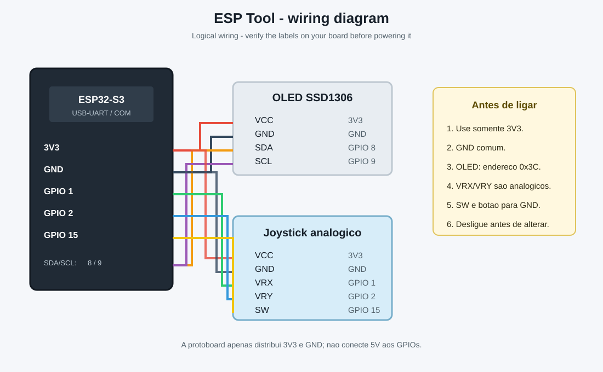

# ESP Tool

Firmware portátil de laboratório para ESP32-S3, voltado a estudo de Wi-Fi, BLE, IoT e eletrônica em dispositivos próprios e rede própria. Os scanners deste projeto são passivos: não há deauthentication, jamming, captura de credenciais, Evil Twin, quebra de senhas, bypass de autenticação, replay de rolling codes ou interferência de rádio.

## Hardware

- ESP32-S3; a configuração está preparada para 16 MB de Flash e PSRAM OPI
- OLED SSD1306 128x64, I2C, 3.3 V
- Joystick analógico com `VRX`, `VRY` e `SW`
- Protoboard e jumpers

O ambiente usa `esp32-s3-devkitc-1` como configuração genérica. Se sua placa tiver outro layout, altere `board` no `platformio.ini` e confirme o tipo de Flash/PSRAM no datasheet. A placa testada foi identificada pelo PlatformIO como `ESP32-S3-DevKitC-1-N8` e informou `PSRAM: 0 bytes` no boot; portanto, não assuma que o módulo é N16R8 sem confirmar a marcação física e o datasheet.

### USB e porta serial

Esta placa possui duas entradas USB-C:

- **USB**: USB nativa do ESP32-S3, usada principalmente para programação/USB CDC.
- **COM**: conversor USB-UART da placa, usado para upload e monitor serial neste projeto.

Para obter os logs, conecte o cabo na entrada marcada **COM**. O Windows pode atribuir números diferentes, como `COM10` ou `COM11`; descubra a porta com `pio device list` e use a mesma porta no upload e no monitor.

## Instalação

1. Instale o VS Code.
2. Instale a extensão PlatformIO IDE.
3. Abra esta pasta como projeto.
4. Conecte a placa por USB-C e selecione a porta serial quando necessário.

Bibliotecas declaradas no PlatformIO:

- Adafruit GFX Library
- Adafruit SSD1306
- Arduino core ESP32, incluindo WiFi, BLE e Preferences/NVS

## Pinagem

Todos os GPIOs ficam em `src/config.h`.

| Função | GPIO |
| --- | ---: |
| OLED SDA | 8 |
| OLED SCL | 9 |
| Joystick VRX | 1 |
| Joystick VRY | 2 |
| Joystick SW/OK | 15 |

`VRX` e `VRY` são entradas analógicas de 12 bits com zona morta; `SW` usa `INPUT_PULLUP` e é acionado em nível baixo. GPIOs do ESP32-S3 trabalham com lógica de 3.3 V. Não aplique 5 V diretamente.

### Ligação do joystick analógico

Diagrama de ligação:



| Pino do módulo | ESP32-S3 |
| --- | --- |
| VCC | 3V3 |
| GND | GND |
| VRX | GPIO 1 |
| VRY | GPIO 2 |
| SW | GPIO 15 |

Se UP/DOWN ou LEFT/RIGHT ficarem invertidos, troque os eixos no código ou inverta a condição correspondente em `InputManager.cpp`.

## Compilar, enviar e monitorar

No terminal do projeto, com o cabo conectado na entrada física **COM**:

```text
pio run
pio device list
pio run --target upload --upload-port COM11
pio device monitor --port COM11 -b 115200
```

Substitua `COM11` pela porta mostrada no seu computador. Depois de abrir o monitor, pressione **RESET/EN**. Um boot funcional começa com mensagens semelhantes a:

```text
[BOOT] Initializing ESP Tool
[BOOT] PSRAM: 0 bytes
[BOOT] Heap livre: ...
[WIFI] Scan started
```

Também é possível usar os botões Build, Upload e Monitor do PlatformIO no VS Code. No boot, o monitor mostra logs com os prefixos `[BOOT]`, `[WIFI]`, `[BLE]`, `[UI]` e `[ERROR]`.

## Interface

Na tela inicial, UP/DOWN selecionam, OK abre e LEFT retorna. RIGHT executa uma ação secundária quando disponível, como rescan ou próxima página. O debounce é feito por `InputManager` sem bloquear o loop.

Apps disponíveis:

- WiFi Scanner: SSID, RSSI, canal e estado de segurança de redes encontradas sem conexão automática.
- Bluetooth: descoberta BLE passiva de nome, endereço e RSSI.
- WiFi Info: MAC, modo, IP, RSSI, gateway e qualidade do sinal.
- System: Flash, PSRAM, heap, CPU e versão do firmware.
- Settings: habilitar Wi-Fi/BLE, screen saver e reinício, persistidos em Preferences/NVS.

## Estrutura

`main.cpp` inicializa os managers. `AppManager` coordena o app ativo; `InputManager`, `DisplayManager` e `SystemManager` isolam hardware e estado. Cada app implementa `begin()`, `update()`, `render()` e `onButton()`.

Para adicionar um app, crie uma classe derivada de `App`, implemente os quatro métodos, registre a instância e aponte uma opção no `HomeApp`. Módulos futuros como PN532, CC1101, IR, microSD e GPS podem seguir essa mesma fronteira sem alterar o loop principal.

## Troubleshooting

- OLED em branco: confirme SDA, SCL, endereço `0x3C` e alimentação de 3.3 V.
- Botões invertidos: confira a ligação ao GND e altere os GPIOs em `src/config.h`.
- PSRAM aparece como `0 bytes`: confirme a variante exata da placa; a configuração `qio_opi`/`opi` não transforma uma placa sem PSRAM em N16R8. O firmware continua funcionando sem PSRAM.
- Upload falha: mantenha BOOT pressionado durante a conexão USB se a placa exigir modo download.
- Monitor sem saída: use a entrada física **COM**, não a entrada **USB**, e abra o monitor na porta retornada por `pio device list`. Feche outros monitores antes de abrir a porta.
- BLE ou Wi-Fi indisponível: verifique as configurações salvas em Settings e reinicie.
